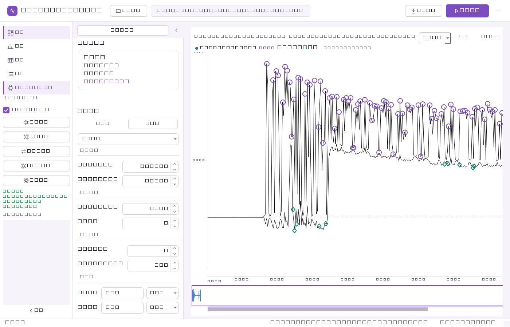
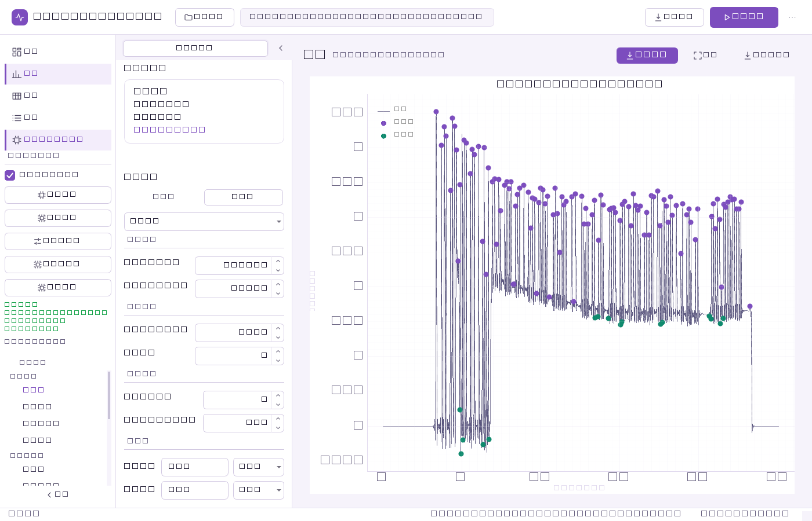
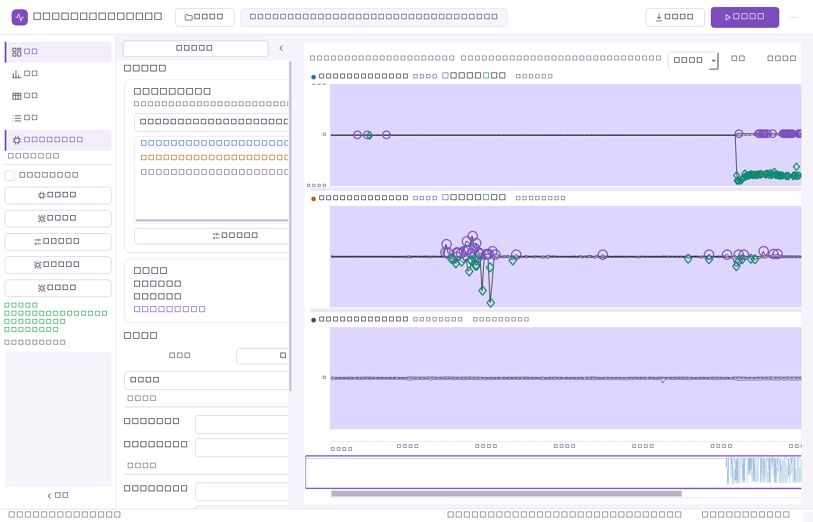
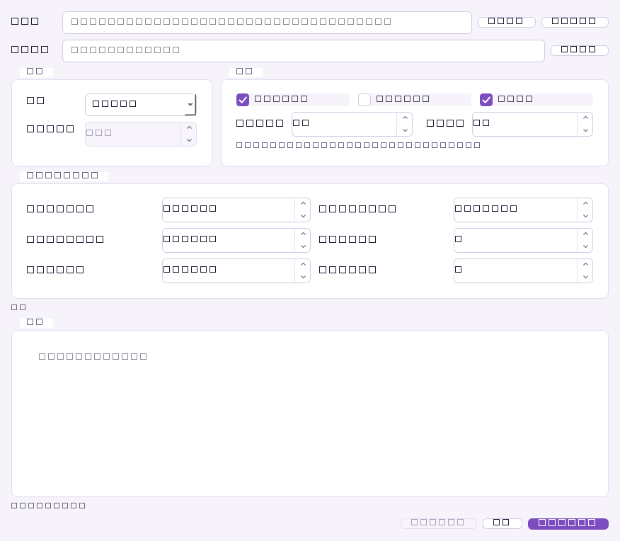
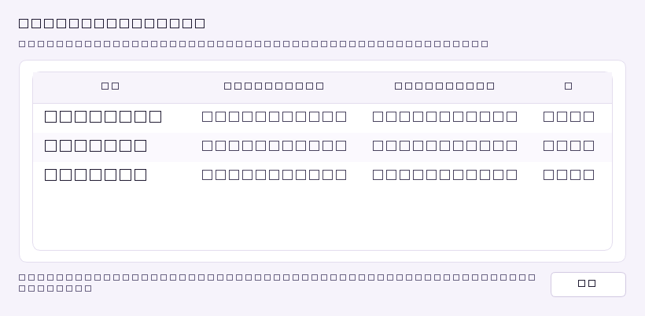
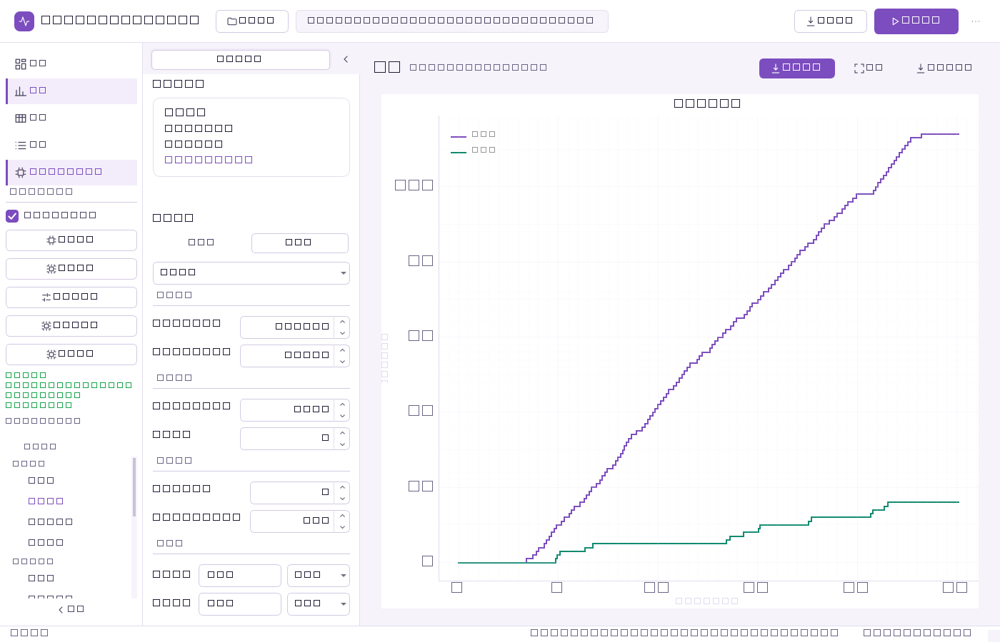
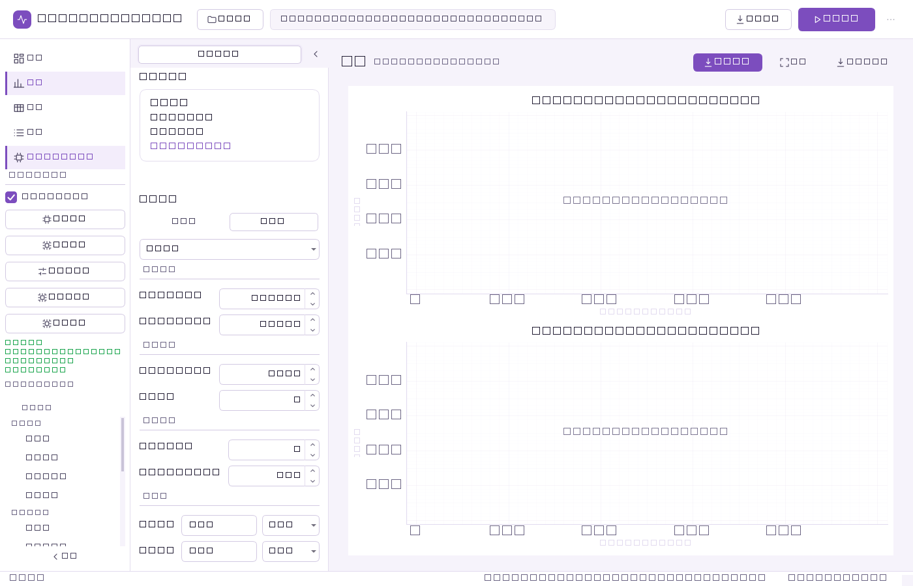

<div align="center">

# Lickometer Pro

**AI Enhanced Edition**


[](https://www.python.org/)
[](LICENSE.txt)
[]()

*ネズミ目（ラット／マウス）の舐め行動（リッキング）マイクロストラクチャー解析ソフトウェア*

[中文](README.md) | [English](README.en.md) | 日本語 | [Français](README.fr.md)

</div>

---

## 目次

- [概要](#概要)
- [主な特徴](#主な特徴)
- [動作環境](#動作環境)
- [インストール](#インストール)
- [自動アップデート](#自動アップデート)
- [クイックスタート](#クイックスタート)
- [使い方](#使い方)
- [スクリーンショット](#スクリーンショット)
- [トラブルシューティング](#トラブルシューティング)
- [FAQ](#faq)
- [ロードマップ](#ロードマップ)
- [貢献](#貢献)
- [変更履歴](#変更履歴)
- [ライセンス](#ライセンス)
- [引用と謝辞](#引用と謝辞)

> **このリポジトリについて**：ここは Lickometer Pro の**公開リリース用リポジトリ**です。配布物（GitHub Releases のインストーラー）、ドキュメント、スクリーンショット、自動アップデート用マニフェストのみを含み、ソースコードは含まれません。

---

## 概要

**Lickometer Pro** は、ネズミ目の舐め行動（リッキング）データを包括的に解析するための専門的なニューロサイエンス向けデスクトップアプリです。Python と PySide6 で構築され（レガシーの CustomTkinter 画面もフォールバックとして維持）、大量の lick 記録データのバッチ処理、バースト（burst）検出、食事（meal）構造の解析、論文投稿に使える品質のグラフによる舐めマイクロストラクチャーの可視化を、研究者に提供します。画面と言語設定は中国語（简体字）で提供されます。

本ソフトウェアは行動神経科学の文献で確立された手法を実装しています。舐め間隔（ILI: Inter-Lick Interval）分布への **Weibull 分布フィッティング**（Davis, 1998 の手法）、McCutcheon Lab の `trompy/lickcalc` に着想を得たバースト検出アルゴリズムなどです。

**Lickometer Pro を選ぶ理由**

- バッチ処理で大量のデータセットを効率的に解析
- 出版品質の可視化グラフを自動生成
- 検証済みの神経科学アルゴリズムをパラメータ設定可能で適用
- 解析結果を Excel にエクスポートして統計解析へ引き継ぐ
- AI モデルの学習による舐めパターン自動分類

---

## 主な特徴

### データ処理

- **複数ファイルの一括バッチ処理** — 進捗表示付きで数百のデータファイルをまとめて解析
- **2本ボトル選好試験（Two-Bottle Preference Test）解析** — 複数チャンネルの摂水量を比較し、統計を自動算出（正极性＝B1・負極性＝B2 のデュアルボトルにも対応）
- **AI による舐め検出分類** — ランダムフォレスト機械学習モデルによる知能的な舐めパターン認識
- **LabChart ネイティブ `.adicht` 対応** — ADInstruments 公式 SDK により、多日・多チャンネル・多 record の記録を直接インポート

### バースト・食事解析

- **バースト／クラスター検出** — lick 間隔（ILI）閾値を設定可能（既定：バースト間ギャップ 1.0 秒、最小 2 回）
- **食事構造（Meal Structure）解析** — 摂食エピソード全体を特定し特徴づけ（GUI のギャップ閾値は 300 秒に固定）
- **バースト内頻度（intraburst frequency）算出** — バースト内の舐め速率を精密に測定

### 統計解析

- **Weibull 分布フィッティング** — ILI 分布のモデル化（Davis 1998 の手法）
- **要約統計** — 30 以上のマイクロストラクチャー指標の包括的な統計レポート
- **昼／夜間の摂取解析** — 24 時間活動プロフィールによる概日リズム解析

### 可視化

- **ラスタプロット** — 舐めイベントの時系列可視化
- **累積舐め曲線（Cumulative Lick Curves）** — 実時間の累積プロット
- **ヒートマップ** — セッション全体の活動パターン
- **14 種のグラフ** — インライン描画。パラメータ変更は次回解析から反映されます（ライブ更新ではありません）

### ユーザー体験

- **トークン駆動のライトテーマ** — ラベンダー／ニュートラルの一貫したカラーパレットと状態色
- **Excel マルチシート出力** — 次の解析にそのまま使える構造化出力
- **プロフェッショナル UI** — タブ型ワークスペース（概要／グラフ／データ／ログ）、KPI ストリップ、インライングラフ、最近使ったファイル、メニューショートカット、非ブロッキングな進捗・検証フィードバック
- **CLI / MCP インターフェース** — GUI を使わないヘッドレス解析（スクリプトや AI エージェントの自動化ワークフロー向け）
- **自動アップデート** — 起動時に新バージョンを確認し、ダウンロード後は上書きインストール（Windows 10/11 x64、ユーザーレベルインストールで管理者権限不要）

---

## 動作環境

| 項目 | 最小 | 推奨 |
|---|---|---|
| **OS** | Windows 10 (x64) | Windows 11 |
| **メモリ** | 4 GB | 8 GB |
| **ディスク** | 1 GB の空き容量 | 2 GB |
| **解像度** | 1280 × 720 | 1920 × 1080 |

開発版（ソース利用時）の Python は 3.10〜3.12 に対応します。インストーラー版は実行環境を同梱するため Python のインストールは不要です。

---

## インストール

### インストーラー版（一般のユーザー向け）

1. [Releases（最新版）](https://github.com/BuTrue/Lickometer-Pro/releases/latest)を開く
2. `LickometerPro_Setup_<バージョン>.exe`（Windows x64）をダウンロード
3. ダブルクリックして実行。セットアップウィザードは中国語で表示され、「下一步（次へ）」を順にクリックします。インストールは**現在ユーザー**レベル（UAC 昇格なし）
4. スタートメニューまたはデスクトップショートカットから **Lickometer Pro** を起動

インストール手順・アンインストール・アップグレードの詳細は [INSTALL.md](INSTALL.md) を参照してください。

---

## 自動アップデート

Lickometer Pro はGitHub上のアップデートマニフェストを参照して新バージョンを確認します。

```
https://raw.githubusercontent.com/BuTrue/Lickometer-Pro/main/update/manifest.json
```

- 起動時に自動でチェックし、手動でも「⋯ → 检查更新…（更新を確認）」から確認できます。
- 新しいバージョンが見つかると「立即下载（今すぐダウンロード）」をクリックでき、ダウンロード後に **SHA-256 を強制検証** の上、サイレントで同じディレクトリへ**上書きインストール**し、自動的に再起動します。
- AI 舐め検出モデルもソフトウェア本体とは独立して更新できます（マニフェストの `model` フィールド経由）。
- 環境変数 `LICKOMETER_UPDATE_URL` でミラー先に切り替え可能です。
- `min_required_version` より古いバージョンでは完全な再インストールが必要です。

---

## クイックスタート

1. **インストールして起動**：上記の手順でインストールし、アプリを起動します。
2. **データを読み込む**：**打开数据（データを開く）** で `.csv` / `.txt` / `.xlsx` / `.adicht` を選択。LabChart ファイルではチャンネル役割の割り当て表（饮水统计＝飲水解析 / 辅助展示＝参考表示 / 忽略＝無視）と波形プレビューが表示され、補助チャンネルは表示のみで解析対象外です。
3. **パラメータ設定**：左パネルで検出・バースト・AI・実験設定を調整します。
4. **解析して確認**：**Start Analysis（一键分析）** をクリックし、KPI ストリップとグループ化されたグラフを確認した後、Excel にエクスポートします。

---

## 使い方

### 基本ワークフロー

1. **データ読み込み** — **打开数据**（`Ctrl+O`）で `.txt` / `.csv` / `.xlsx` / `.adicht` をインポート。LabChart では飲水チャンネルと補助チャンネルを選び、波形をプレビューしてから **一键分析**
2. **パラメータ設定** — 左パネルでバースト閾値（既定：ギャップ 1.0 秒、最小 2 回）、食事基準（GUI 固定 300 秒）、解析オプションを設定
3. **解析実行** — パイプラインを開始（`Ctrl+R`）。ステータスバーに進捗が表示され、完了すると KPI ストリップが現れます
4. **確認と出力** — グラフカードを切り替えて閲覧し、**Export Excel**（`Ctrl+E`）または**综合导出（総合エクスポート）**で保存

### バッチ処理

**Batch Processing（批量处理）** ウィンドウで複数ファイルを一度の操作で解析できます。

- ファイルやフォルダ全体を選択
- すべてのデータセットに同一パラメータを適用（パラメータスナップショットで固定）
- 複数シート構成の単一 Excel ワークブックに出力

### フォルダ一括解析（LabChart 複数記録）

**文件 → 文件夹批量分析** で、フォルダ内の `.adicht` を record 単位／実験日単位／record＋日単位でまとめ出力できます（1 セグメント＝1 ファイルの出力モードも選択可）。各ワークブックには 概览（概要）、动物汇总（動物別集計）、分段明细、通道识别（チャンネル識別）、按日汇总、B1 vs B2、昼夜节律（概日）ヒートマップ、爆发明细（バースト詳細）、ILI 分布（全体 vs バースト内）、指标说明 と、編集可能な Excel ネイティブチャートが含まれます。フォルダモードでは `_批量汇总.xlsx` も出力され、1 つの破損ファイルがあってもバッチ全体は中断しません。

### AI 舐め分類器の再学習

左側の **AI 智能过滤** カード（**训练模型**）から AI トレーナーを開きます。飲水データと安静データの LabChart TXT エクスポート 1 本ずつから学習でき、極性反転・ベースラインドリフト・ゲイン変化のデータ拡張が自動適用されます。グループ交差検証（同じピーク由来の拡張コピーは必ず同一フォールド）で、リリース済みモデルは accuracy 0.935〜0.970、F1 0.947〜0.976、AUC 0.987〜0.995 を記録しています。アプリは `lick_model.onnx` を併走し、整合が取れていれば ONNX 推論を使い、そうでなければ pkl チェックポイントへフォールバックします。**模型设置…** からキャッシュ統計・ワンクリック再学習・ONNX エクスポート・ロールバックが可能です。手動ラベルは `%APPDATA%\LickometerPro\training\labeled_samples.csv` に保存されます。AI 認識はオプトインで、既定の解析は分類器推論をスキップします。

### エージェント／自動化インターフェース（CLI・MCP）

解析エンジンは GUI を介さないヘッドレス呼び出しにも対応し、スクリプトや AI エージェントが直接解析を実行できます（開発版での利用。機能と詳細は本体プロジェクトのドキュメント参照）。

- **CLI** — `analyze`（デュアルボトル既定／`--single`・`--polarity`・`--format`・`--with-ili-gaussian` 付き）、`batch`（複数ファイルの JSON 配列出力）、`compare`（平均／SEM／中央値の比較）
- **MCP サーバー（stdio）** — `analyze_file`、`batch_analyze`、`compare_files`、`compare_groups`、`compute_burst_details`、`exclude_long_licks`、`compute_pca`、`compute_activity_heatmap`、`compute_ili_gaussian`、`get_info` の 10 ツールを公開
- どの経路も同一の解析パイプラインを共有するため、GUI と同じ結果が得られます

---

## スクリーンショット

| メイン画面（ダッシュボード） | 解析後のグラフワークスペース | LabChart 読み込み・チャンネル設定 |
|---|---|---|
|  |  |  |

| バッチ処理ダイアログ | 統計ダイアログ | AI トレーナー |
|---|---|---|
|  |  |  |

| 累積舐め曲線 | バースト確率（Weibull） |
|---|---|
|  |  |

---

## トラブルシューティング

| 症状 | 原因 | 対処 |
|---|---|---|
| インストール時に「ファイルが使用中」と表示 | アプリが起動中 | Lickometer Pro を閉じて再試行。インストーラーはアプリの終了を自動要求します |
| ウイルス対策ソフトにブロックされる | インストーラーはコード未署名 | 「実行」を選択するか、Releases 掲載の SHA-256 と照合してください |
| 起動後画面が真っ白 | 環境設定の破損／OS の問題 | Windows 10 以上の 64 bit を確認し、それでも異常なら `%APPDATA%\LickometerPro\config` を削除して再起動 |
| Excel エクスポート失敗 | Openpyxl のバージョン競合（開発版） | `pip install --upgrade openpyxl` |
| バッチ処理でメモリ不足 | データセットが大きい | メモリを増やすかファイルを分割して処理 |

解決しない問題は GitHub Issue に、OS／バージョン、エラーメッセージ（トレースバック）、再現手順、匿名化したサンプルデータを添えて報告してください。

---

## FAQ

**Q: 対応データフォーマットは？**
A: `.txt`、`.csv`、`.xlsx`、LabChart ネイティブ `.adicht` です。テキスト／CSV は時刻列と信号列を含めてください。

**Q: 対象動物はラットだけですか？**
A:  いいえ。ラット・マウスいずれのネズミ目にも使え、水／糖水の 2 本ボトル選好実験に対応します。ランダムフォレスト分類器は一般的な舐めマイクロストラクチャー特徴で学習されており、適切な学習データで種に適応できます。

**Q: 管理者権限なしでインストールできますか？**
A: できます。インストールは現在ユーザーレベルで完結し、UAC ポップアップは出ません。

**Q: バグ報告・機能要望は？**
A: このリポジトリの Issue タッカーを利用してください。

---

## ロードマップ

- [x] **v1.2.0** — Batch 2.0（パラメータロック、タブ型プロットワークスペース、パープルテーマ）
- [x] **v1.7.0** — 17 解析モジュール、CLI/MCP ツールの拡充、自動アップデート（最初の一般公開版）
- [ ] **Unreleased** — タブ型ワークスペース、インラインプロット、最近使ったファイル、非ブロッキングフィードバック
- [ ] **将来** — クラウドデータ保存と共同編集

---

## 貢献

このリポジトリは配布物とドキュメント専用です。バグ報告・機能要望は GitHub Issue で受け付けます。

Issue に含めてほしい情報：

- OS とアプリのバージョン
- 再現手順
- 期待挙動と実際の挙動
- 該当する場合、匿名化したサンプルデータファイル

コードへの貢献（fork・ブランチ・テスト追加・Pull Request）は開発版リポジトリで行ってください。開発時は PEP 8 準拠、公開関数／クラスへの docstring（Google/NumPy スタイル）、新規機能への単体テスト追加、Python 3.10〜3.12 互換の維持をガイドラインとしています。

---

## 変更履歴

主な変更は [CHANGELOG.md](CHANGELOG.md)、バージョン別の公開ノートは [release-notes/](release-notes/) を参照してください。

---

## ライセンス

本プロジェクトは **MIT License** の下で提供されます。詳細は [LICENSE.txt](LICENSE.txt)。

```
MIT License

Copyright (c) 2025 Lickometer Pro
```

---

## 引用と謝辞

### 学術参考文献

研究で Lickometer Pro を使用した場合は以下を引用してください。

1. **Weibull 解析手法**：Davis, J. D. (1998). A model of the accumulation of internal stimulation in the rat: The satiating effect of food. *Appetite*, 31(3), 435-447. https://doi.org/10.1006/appe.1998.0167

2. **バースト検出アルゴリズム**：McCutcheon Lab. `trompy/lickcalc` — 舐めマイクロストラクチャー解析用 Python パッケージ。https://github.com/mccutcheonlab/trompy

### 謝辞

このツールを可能にする Python 科学計算エコシステムを育ててきたオープンソースコミュニティに感謝します。

特に：

- 既定の Qt インターフェースを提供する **PySide6** チーム
- レガシーフォールバック UI の **CustomTkinter** チーム
- オープンソースの舐め解析アルゴリズムを提供する **McCutcheon Lab**
- 堅牢な科学計算ツールを提供する **NumPy、SciPy、scikit-learn、matplotlib** コミュニティ

---

<div align="center">

**ニューロサイエンス研究のために**

*Lickometer Pro (c) 2025*

</div>
